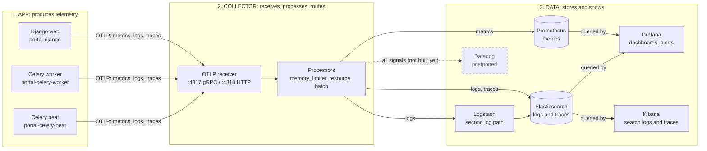
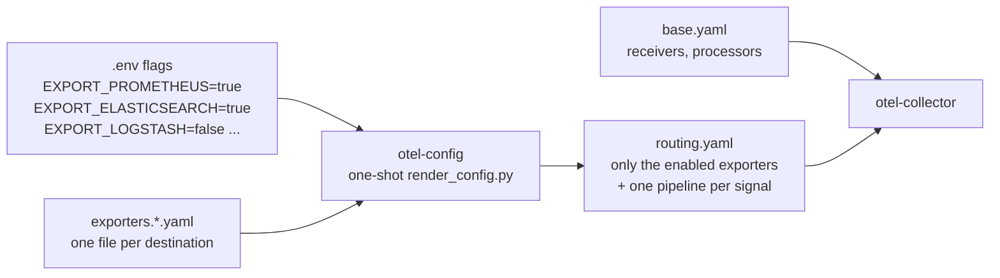

# Unified Observability & Telemetry Aggregation Platform

A hands-on learning project: one instrumented Django app, one OpenTelemetry Collector, many observability backends (Prometheus, Grafana, ELK, optional Datadog).

**Core idea: instrument once, collect centrally, distribute wherever required.**

## Architecture: App → Collector → Data

OpenTelemetry (OTel) splits observability into three independent parts. Each can change without touching the others.



The app knows **one address** (the Collector). The Collector knows **every destination**. The backends know **nothing about the app**. Adding or removing a backend changes only the middle box.

### 1. The app: produces telemetry (vendor-neutral)

`app/` is a Django "Operations Management Portal" plus Celery worker and beat. Three containers, three `service.name`s (`portal-django`, `portal-celery-worker`, `portal-celery-beat`).

The OTel SDK (`app/config/telemetry.py`) emits the three **signals**:

| Signal | What it answers | How it's produced here |
|---|---|---|
| **Metrics** | *How much / how fast, in aggregate?* | Auto: HTTP server/client duration, active requests. Custom (`app/portal/metrics.py`): cache hit/miss, Celery task outcomes and duration, DB query duration, queue depth, uptime. |
| **Logs** | *What happened, exactly?* | JSON to stdout **and** OTLP. Every line carries `trace_id` / `span_id`. Sensitive keys (password, token, ...) are redacted. |
| **Traces** | *Where did this one request spend its time?* | Auto-instrumented Django, PostgreSQL, Redis and `requests`. Trace context is propagated through the Celery queue, so one trace follows a request from the API into the background worker. |

The app's only telemetry configuration is `OTEL_EXPORTER_OTLP_ENDPOINT` (the Collector's address). It contains **no** Prometheus, Elastic or Datadog code. If the Collector is down, the SDK drops data in bounded buffers and requests keep working.

### 2. The collector: the gateway in the middle

`observability/otel-collector/` runs the OpenTelemetry Collector, the only thing the app talks to. Everything is a pipeline of **receivers → processors → exporters**, one independent pipeline per signal:

- **Receivers**: accept OTLP on `:4317` (gRPC) / `:4318` (HTTP).
- **Processors** (order matters): `memory_limiter` (first; protects the Collector) → `resource` (stamps `deployment.environment` on everything) → `batch` (last; fewer, bigger writes).
- **Exporters**: where data goes. Adding or removing a backend is a Collector config change, with **zero app changes**.



Files in `observability/otel-collector/`:
- `base.yaml`: receivers, processors, self-metrics, health check.
- `exporters.<name>.yaml`: one file per destination (`debug`, `prometheus`, `elasticsearch`, `logstash`). Its first line, `# routing: exporter=... signals=... default=...`, declares how it is routed, so a new destination is just a new file.
- `render_config.py`: run once by the `otel-config` container; reads the `EXPORT_*` flags below and writes the Collector's routing (`exporters:` + one pipeline per signal) containing **only the enabled destinations**.

#### Turning destinations on and off

Every available destination is **on by default**, so `make up` shows the whole platform working at once. To stop sending to one, flip its flag in `.env` and reload; nothing else changes and the app is never touched:

```
EXPORT_PROMETHEUS=false   # in .env
make collector-reload     # re-renders routing, restarts only the Collector
make routes               # shows where each signal now goes
```

| Flag | Receives | Default |
|---|---|---|
| `EXPORT_DEBUG` | all signals (printed in the Collector log) | on |
| `EXPORT_PROMETHEUS` | metrics (scrape endpoint `:8889`) | on |
| `EXPORT_ELASTICSEARCH` | logs + traces (direct exporter; **drops data if Elasticsearch is unreachable**, see `docs/signal-compat.md`) | on |
| `EXPORT_LOGSTASH` | logs via Logstash into their own stream (retries; the durable log path) | on |
| `EXPORT_DATADOG` | all signals | later phase |

A signal with every destination off still gets a valid (no-op) pipeline. To add a destination: add `exporters.<name>.yaml`, one row in `render_config.py`, one flag in `docker-compose.yml`.

### 3. The data: backends that store and show it

Not every backend gets every signal; each gets what it's good at:

| Signal | Prometheus | Elasticsearch | Datadog (optional) |
|---|---|---|---|
| Metrics | ✅ | – | ✅ |
| Logs | – | ✅ | ✅ |
| Traces | – | ✅ | ✅ |

Grafana stores nothing: it queries Prometheus and Elasticsearch. Kibana is Elasticsearch's own UI. Trace IDs in logs let you jump from a log line to its trace.

### Dashboards (Grafana → "Observability Platform" folder)
- **Application Performance**: request rate, 5xx rate, p50/p95/p99 latency, slowest routes, DB query time, cache hit ratio, external API calls.
- **Background Processing**: Celery queue depth, success ratio, failures, duration by task.
- **Application Performance** also has a Logs row (log volume by level, recent warnings/errors) and links to the matching Kibana searches.
- **Infrastructure Health**: host CPU/memory/load/network (Collector `hostmetrics`; this is the Docker *host*, not per-container usage) plus the telemetry pipeline's own health: what the Collector receives, what each exporter sends, export failures.

Dashboards are files (`observability/grafana/dashboards/*.json`) and read-only in the UI; change the JSON, not the screen.

### Following one request across logs and traces

Every log line and span carries the same `trace.id`. In Kibana, open the **Portal: logs and traces overview** dashboard, copy a `trace.id` from an error, and paste it into the **Portal: follow a trace** saved search: you get that request's log lines and spans together, in time order. Grafana log lines have a "Follow trace in Kibana" link on `trace.id`. Field-name and severity differences between signals are listed in [`docs/signal-compat.md`](docs/signal-compat.md).

### Where this build is today

| Part | Status |
|---|---|
| App + Postgres + Redis + Celery | ✅ built |
| App instrumentation (metrics, logs, traces) | ✅ built, verified end-to-end |
| Collector | ✅ flag-driven routing, self-metrics, health endpoint |
| Prometheus | ✅ scraping the Collector; 6 alert rules (`observability/prometheus/rules`) at http://127.0.0.1:9090 |
| Grafana | ✅ http://127.0.0.1:3000 (user `admin`, password = `GF_SECURITY_ADMIN_PASSWORD` in `.env`). Prometheus data source, 3 dashboards, 2 alert rules, all provisioned from `observability/grafana/` |
| ELK | ✅ Elasticsearch (logs + traces, 7-day retention), Logstash (second log path), Kibana at http://127.0.0.1:5601 (user `elastic`, password = `ELASTIC_PASSWORD` in `.env`). Grafana reads logs from Elasticsearch |
| Docs | ✅ architecture, deployment, troubleshooting, limitations, signal compatibility |
| Scenarios | ✅ six scripted, self-checking operational scenarios with demo fault injection ([`scenarios/`](scenarios/README.md)) |
| Datadog | ⏸ postponed (optional; needs an external account and API key). Adding it later is one `exporters.datadog.yaml`, one `DESTINATIONS` row and an `EXPORT_DATADOG` flag, with no app change |

See what the Collector receives: `docker compose logs -f otel-collector`.
Full span detail: `DEBUG_EXPORTER_VERBOSITY=detailed docker compose up -d otel-collector`.

## Operational scenarios

Six reproducible exercises show observability in practice instead of just dashboards: a slow endpoint, application errors, a Celery failure, a slow database, adding a new destination, and pipeline failures. Each one injects a controlled fault (`POST /api/_faults/`, staff only, `FAULTS_ENABLED=true`, auto-expires after 15 minutes), drives load, then **checks automatically** that the effect is visible in Prometheus, Elasticsearch and the alerts.

```
make demo-user       # creates demo (load) and ops-admin (staff, fault control)
make scenario N=1    # one scenario, about 3 to 6 minutes (telemetry needs ~30s to reach the backends)
make scenarios       # all six
```

Details and "where to look in the UI" for each are in [`scenarios/README.md`](scenarios/README.md). The Grafana *Application Performance* dashboard shows a red **Active fault injections** banner while a fault is on.

## Repository layout
- `app/` – Django demo application (no backend-specific code)
- `observability/` – Collector, Prometheus, Grafana, Elasticsearch/Logstash/Kibana config (Datadog to come)
- `scenarios/` – load generator and (later) reproducible failure demos
- `docs/` – signal compatibility notes (more to come)

## Getting started
```
make init         # writes .env with random secrets (first run only)
make up           # build and start everything, waits for healthchecks (first run pulls ~4 GB of images)
make demo-user    # users: demo (load) and ops-admin (staff, fault control)
make verify       # checks the spec's acceptance criteria against the running stack (~1.5 min)
make test         # pytest inside the django container
make load         # 60 s of mixed API traffic (generates telemetry)
```
Needs Docker with Compose v2 and about 8 GB of free RAM. API on http://127.0.0.1:8000 (`/healthz`, `/readyz`, `/api/assets/`, `/api/workorders/`, `/api/reports/`, `/api/external/rates/`). Celery Beat emits baseline activity (heartbeat, synthetic load, stale sweep, one log record per severity) even with no traffic. Full instructions, URLs and logins: [`docs/deployment.md`](docs/deployment.md).

## Docs
- [`demo.md`](demo.md): guided full run-through, from start to breaking things on purpose
- [`docs/architecture.md`](docs/architecture.md): components, networks, how one request flows, design decisions
- [`docs/deployment.md`](docs/deployment.md): requirements, first run, URLs and logins, configuration, adding a destination
- [`docs/troubleshooting.md`](docs/troubleshooting.md): symptoms and causes (mostly real problems met while building this)
- [`docs/signal-compat.md`](docs/signal-compat.md): how each signal changes shape per backend, and measured delivery guarantees
- [`docs/limitations.md`](docs/limitations.md): demo vs production
- [`scenarios/README.md`](scenarios/README.md): the six operational scenarios
- [`CLAUDE.md`](CLAUDE.md): guidance for Claude Code. Local planning docs (`spec.md`, `TECHNICAL_SPEC.md`) are git-ignored.
