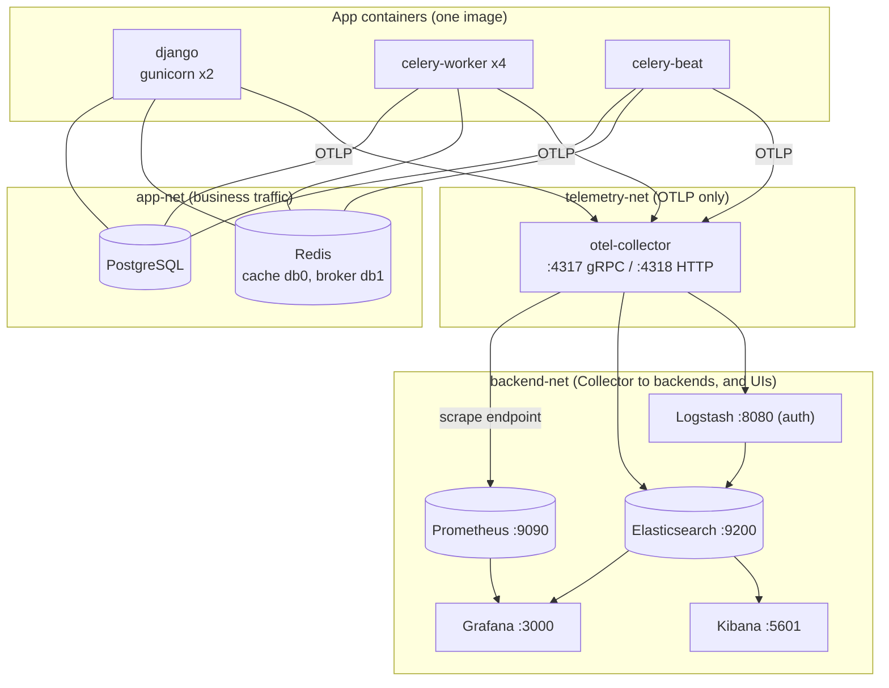
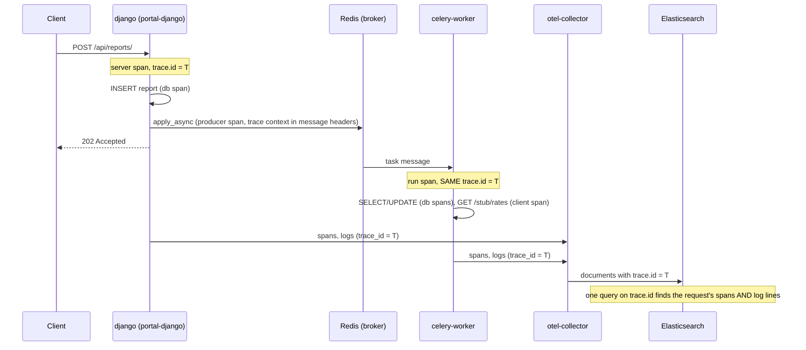
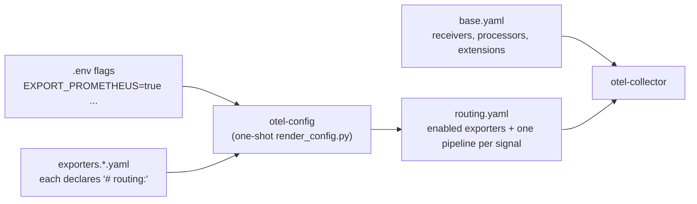

# Architecture

One principle: **instrument once, collect centrally, distribute wherever required.** The application emits standard OpenTelemetry (OTLP) and knows a single address. Everything else is the Collector's business.

## Components and networks

- The app containers sit on `app-net` and `telemetry-net` only. They cannot reach Prometheus, Elasticsearch, Logstash or Grafana (`make verify` proves it).
- The Collector is the only bridge between the app side and the backend side.
- PostgreSQL and Redis are not on any telemetry network. All published ports bind to `127.0.0.1`.

## What flows where

| Signal | Producer | Collector pipeline | Destinations |
|---|---|---|---|
| Metrics | OTel SDK (auto + `portal.*` custom), plus Collector `hostmetrics` | `otlp, hostmetrics` → `memory_limiter, resource, batch` | Prometheus (scrape of `:8889`), debug |
| Logs | Python logging via OTLP handler | `otlp` → `memory_limiter, resource, batch` | Elasticsearch (direct), Logstash → Elasticsearch, debug |
| Traces | Auto-instrumented Django, psycopg, Redis, requests, Celery | `otlp` → `memory_limiter, resource, filter/noise, batch` | Elasticsearch, debug |

Grafana stores nothing: it queries Prometheus (metrics) and Elasticsearch (logs, traces). Kibana is Elasticsearch's own UI.

## One request across the system

## Collector configuration

A destination is a file. `render_config.py` discovers `exporters.<name>.yaml`, reads its `# routing: exporter=<id> signals=<csv> default=<bool>` header, and includes it when `EXPORT_<NAME>` is true (or the name is in `EXPORT_EXTRA`). Disabled destinations are never loaded, so one that needs credentials costs nothing until enabled. After changing flags or fragments: `make collector-reload`.

## Design decisions worth knowing

| Decision | Why |
|---|---|
| Prometheus **scrapes** the Collector (`prometheus` exporter) rather than receiving remote-write | Simple, standard, and gives Prometheus its own `up` signal for the Collector |
| Spans are normalised in an Elasticsearch **ingest pipeline** | The Collector writes logs in ECS names (`trace.id`) but spans in its own schema (`TraceId`); one pipeline lets a single `trace.id` query match both |
| IDs are **validated as hex at ingest**, failing closed | `trace.id` is placed into links and queries |
| `service.instance.id` is unique **per OS process** | Several gunicorn/Celery processes sharing one identity overwrite each other's cumulative counters |
| Seconds-valued histograms get **explicit second-scale buckets** | SDK default buckets are millisecond-sized; percentiles would be meaningless |
| Logstash is a **second log path**, not the only one | Shows the "L" in ELK, and (measured) it is the durable path to Elasticsearch |
| Everything in Grafana/Kibana/Elasticsearch is **provisioned from files** | Reproducible; no click-ops state |
| Demo faults are Redis toggles with a **TTL**, staff-only, behind `FAULTS_ENABLED` | Scenarios need no redeploy; a forgotten fault expires |
